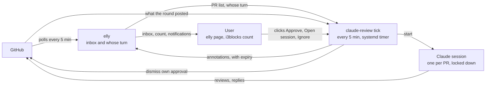

# elly annotations and claude-review runner

Design, 2026-10-30, persona-reviewed and revised 2026-10-31. Not built yet,
apart from elly's escaping fix (elly bde870b). The tool's own README arrives
with its code.

elly becomes the review inbox: claude-review runs rounds unattended and marks
each PR in elly as handled or needing the user, with Approve and Open-session
links.

## Problem

The user gets 5–30 review-request emails a day and relays every claude-review
round by hand. Only the first round on a PR gets a human read of the
description and diff; every later round is a click to re-run, then a
copy-pasted approve command.

An unattended runner removes the relay, but its state (this PR is handled,
this one needs the user) must survive a missed notification, a meeting or a
day offline. elly already owns the place the user looks, its page and the
i3blocks count, so that state goes there.

elly must stay unchanged for anyone who runs no such tool, and must never
learn what Claude is.

## Who owns what

Two tools, one boundary: elly reads GitHub and shows the inbox; claude-review
does everything Claude-shaped, including deciding when a round runs.

| Concern | elly | claude-review |
| --- | --- | --- |
| Poll GitHub, store PR facts | yes | no |
| Score whose turn it is (points) | yes | no |
| Show the inbox: page, i3blocks count | yes | no |
| Send desktop notifications | yes | no |
| Store and render annotations, with expiry | yes, generic | no |
| Review one PR in a session (prompts, clone, PR-derived session id) | no | yes, as today |
| Refuse a round while the PR's session is open | no | yes, as today |
| Approve at the reviewed commit (`approve --at`) | no | yes, as today |
| Ledger: acceptance, ignore, rounds, approve tokens | no | new |
| Decide when a round runs, and with which permissions | no | new: `tick` |
| Read a finished round's outcome, checked against GitHub | no | new: `tick` |
| Write annotations to elly | no | new: `tick` |
| Handle clicks on annotation links | no | new: `approve`, `attach`, `ignore` verbs on `claude-review://` |
| Write to GitHub | never | yes: reviews, replies, approvals, dismissing the user's own approval |

elly stays read-only toward GitHub. An approval goes out through
`claude-review approve`; elly's next poll sees it, and the next tick drops the
annotation. GitHub holds the approval and the annotation is an expiring cache,
so no state is kept in two places.

claude-review moves from a draft PR in a work repo into this public repo, so
prompt changes and the runner ship without review rounds. The move first
scrubs the work repo's org and repo names from the README, the `go.mod`
module path, the userscript `@namespace` and the test fixtures. Nothing secret
was found in it. A cut-down version can return to the team later.

## Flow



Only claude-review writes to GitHub: review comments unattended, approvals
only on the user's click. elly reads GitHub and shows what the user owes.

## claude-review: what it gains

One binary, no daemon: a systemd user timer runs `claude-review tick` every 5
minutes (`OnCalendar=*:0/5`, `Persistent=true`, so a tick missed during
suspend runs on wake), and each tick exits when done.

### The ledger

A small sqlite file in `~/.local/state/claude-review`, owned by
claude-review alone. It holds:

- **Acceptance**: one row per PR, written by the user's own first
  `claude-review://` click on the PR, with the head and base commit at that
  moment. An existing session file is not acceptance.
- **Ignore**: sticky, set from an Ignore link, cleared by the next first-look
  click. elly's bury stays a display preference: elly unburies a PR whose
  `LastUpdated` moves, so bury cannot stop rounds.
- **Rounds**: each round is recorded when it starts (PR, head, trigger) and
  marked read when its result is processed.
- **Approve tokens**: one-time, minted by `tick` for one PR at one head.
- **Daily round count** per PR.

### Each tick

1. Read `GET /api/v0/prs` from elly. If elly does not answer, write nothing
   and exit; existing annotations expire on their own.
2. Pick candidates: the repo is in `review_repos` in claude-review's config
   (`owner/*` for a whole owner, `owner/repo` for one repo), the user did not
   author the PR, it is accepted and not ignored, and
   it is the user's turn: review requested, re-review requested,
   `ThreadsActionable` above zero, or a new head commit since the last round.
   Changes made by the user's own account trigger nothing, so a round's own
   review cannot start the next round.
3. Send a PR back to the first-look gate (no rounds, a `needs_you` row asking
   for a fresh look) when its head no longer descends from the accepted head
   or its base branch changed since acceptance.
4. Skip a PR the ledger already started a round for at the same head and
   trigger. Past the per-PR daily cap, mark it `needs_you` with "paused"
   instead of starting a round.
5. Start the round in the PR's session, resumed, with `terminal: false`, at
   most 2 at once, under `capped`, and under the launch policy below. A PR
   whose session is running or open in a terminal starts nothing, by the same
   check a click uses today.
6. For every round the ledger started and has not marked read, decide the
   outcome from GitHub and the ledger, never from the session's text alone
   (next section). Mark it read.
7. Re-send every live annotation with a fresh expiry. Delete one only on
   positive evidence: the user's own approval stands at the current head, or
   GitHub reports the PR merged or closed. A PR missing from one elly read is
   not evidence; its annotation expires instead.

### Reading a round's outcome

The session's last message carries one of two fixed lines: the approve line
(`claude-review approve <url> --at <sha>`) or the question line, a new fixed
closing line for a round that ends with a question only the user can answer.
Neither is trusted on its own.

- **Approve link**: only when the session's approve line names the PR and the
  head `tick` recorded at the round's start, and GitHub shows that the round
  posted no new review comments and opened no threads, and none of the user's
  threads on the PR are unresolved. The link is built from the ledger, never
  from the session's text, and carries a one-time token. The row shows the
  round summary and how much changed since the user's last approval. No
  confirmation dialog. An approve line conditioned on CI ("approve once
  green") counts as approve: a red build is the author's to fix.
- **Question line**: `needs_you` with an Open-session link.
- **Findings after the user's approval**: when the round posted new review
  comments at the current head while the user's approval stands at an earlier
  commit, `tick` dismisses that approval, with a message ending `--claude`,
  and marks the PR `needs_you`. Any new finding counts; severity is not
  judged. A steered round can therefore block a merge, never let one through.
  This needs write access and no dismissal restriction on the repo.
- **Clean round under a standing approval**: `handled`. Approval survival is a
  per-repo setting that can change, so `tick` reads the user's latest review
  on the PR from GitHub, never the setting and never elly's `ReviewStatus`,
  which is the PR's overall decision and would count another reviewer's
  approval as the user's.
- **`handled` otherwise** needs positive evidence: a review by the user's
  account at the round's head, posted during the round. It links to that
  review.
- **Anything else** (a crash, an expired `gh` token, a rate limit, a stalled
  prompt, a reboot, neither line printed): retry once, then `needs_you` with
  "round failed" and an Open-session link.

`handled` suppresses only the review-owed reasons in elly. A reason outside
the triggers, such as a top-level question from the author, still counts.

### Launch policy

An unattended round runs with nobody watching, and the PR author picks the
moment by pushing. It must not inherit the user's settings, which today run in
auto mode and allow `Bash(gh *)` and `Bash(curl *)`; the existing deny rules
cover only `gh api`, the `gh pr`/`gh issue` write commands and
`claude-review approve`, so `curl`, `gh gist create` and `gh repo clone` pass.

`tick` owns the launch arguments:

- an explicit permission mode, with the user's settings excluded;
- an allow list scoped to the PR: read the clone, `gh pr view` and
  `gh pr diff` for that PR, `claude-review threads` and `post` for that PR;
- everything else denied, including reads of secret-shaped paths (`.env`,
  key and credential files);
- a test that fails if the launch arguments loosen.

The README's claim that a round cannot read other repositories or reach
anything else on the token is false under today's settings; it gets corrected
when the README moves.

Rounds resume the PR's one session, accepting that an instruction planted in
an earlier commit or reply stays in the transcript after the author removes
it. The launch policy and the GitHub checks on Approve bound what it can do:
bad comments or a blocked merge, never an approval.

### URL verbs

They extend the path the userscript, Thunderbird and wee already open
(`claude-review://<owner>/<repo>/<n>`), so those keep working unchanged and an
org named like a verb cannot collide.

- `claude-review://<owner>/<repo>/<n>/approve?at=<sha>&token=<t>` runs
  `approve --at` only when the token is one `tick` minted for that PR and sha
  and has not been used; anything else is refused. `approve --at` still
  refuses a head that moved since the review. Without the token, anyone who
  can show the user a link (Slack, a web page) could get unreviewed code
  approved in one click, and the head check would not stop them, because the
  author knows the head.
- `claude-review://<owner>/<repo>/<n>/attach` opens a terminal on the session.
- `claude-review://<owner>/<repo>/<n>/ignore` sets the sticky ignore. A
  forged one only stops automation on that PR.

The Thunderbird native host passes only `claude-review://[\w.-]+/[\w.-]+/\d+`
(`re.fullmatch` in `nix/thunderbird.nix`), so mail cannot carry a verb. That
pattern stays, and gets a test.

## elly annotations: storage and API

Annotations get their own table, because elly replaces the `prs` table on
every fetch and a column there would be wiped every 5 minutes.

```sql
create table if not exists annotations (
    pr_url     text not null,
    source     text not null,
    state      text not null check (state in ('handled', 'needs_you')),
    note       text not null default '',
    links      text not null default '[]',
    expires_at text not null,
    primary key (pr_url, source)
);
```

Expired rows are purged on write. A row is never deleted because its PR was
missing from one fetch.

elly's refresh (`StoreRepoPrs`) today deletes every row in `prs` and inserts
the new ones one by one, outside a transaction, so a reader mid-refresh sees a
short list. It moves into one transaction.

```
PUT    /api/v0/prs/{prUrl}/annotations/{source}
       {"state":"needs_you","note":"…","links":[{"label":"…","url":"…"}],"expiresAt":"2026-10-30T14:15:00Z"}
DELETE /api/v0/prs/{prUrl}/annotations/{source}
GET    /api/v0/prs    each row gains Annotations: [...], unexpired only, expiresAt as stored
```

`{prUrl}` is encoded as in the existing bury and golden routes. `source` is
free text to elly; claude-review writes as `claude-review`.

The links claude-review writes:

| Link | When | URL |
| --- | --- | --- |
| Approve | the checks under "Reading a round's outcome" pass | `claude-review://<owner>/<repo>/<n>/approve?at=<sha>&token=<t>` |
| Open session | question line, failed round | `claude-review://<owner>/<repo>/<n>/attach` |
| Ignore | every `needs_you` row | `claude-review://<owner>/<repo>/<n>/ignore` |
| Round summary | every finished round | `https://github.com/<owner>/<repo>/pull/<n>#pullrequestreview-<id>` |

## Validation and rendering

elly rejects anything outside these limits on write, and escapes everything
on render.

| Field | Rule |
| --- | --- |
| `prUrl` | a PR elly currently lists, else 404 |
| `source` | 1–40 characters of `[a-z0-9-]` |
| `state` | `handled` or `needs_you` |
| `note` | at most 200 characters, plain text |
| `links` | at most 4, each exactly `{label, url}` |
| `label` | at most 40 characters, plain text |
| `url` | at most 2048 characters; scheme `https` or one named in elly's `-annotation-schemes` flag, empty by default |
| `expiresAt` | RFC 3339, between 1 minute and 24 hours from now; stored as is in `expires_at` and returned unchanged |
| body | at most 4 KiB, unknown fields rejected |

- The page uses `html/template` since elly bde870b, so `note` and `label` are
  escaped. Before that, PR titles rendered raw.
- `html/template` replaces a non-http(s) `href` with `#ZgotmplZ`. An
  allowlisted custom scheme is passed as `template.URL` only after the check
  above, repeated at render time against the current flag, so restarting elly
  without the flag revokes the scheme.
- A custom-scheme link renders with its verb visible next to the label, so a
  label cannot disguise an approve link as "Open session".
- With no annotations, the page and the count are exactly as today.

## Effect on the count

The i3blocks number becomes the PRs that need the user, so zero is reachable
for review work. elly's scoring of the user's own PRs is unchanged: a stale
or reviewer-less own PR keeps counting until it is closed or shipped.

- `handled`: the PR's review-owed reasons stop counting and it sorts below
  everything on the user; the row stays visible with its note.
- `needs_you`: the PR counts and sorts as on the user even when elly scores it
  0, for example a clean round on a PR elly sees as waiting on the author.
- Two sources disagreeing: `needs_you` wins.
- An expired annotation is ignored, so a dead runner fails toward showing more
  PRs, never fewer.

## Notifications

elly sends every notification, and claude-review sends none: one notifier
covers the user's own PRs and claude-review's results alike.

On each fetch elly compares every PR's point reasons with the previous fetch.
A PR that gains one of the reasons below gets one desktop notification: the PR
title and the new reason in elly's own words. A `needs_you` annotation counts
as a reason, its note as the words.

| Event | Reason elly already computes |
| --- | --- |
| Own PR approved | Own PR is approved, should be a simple merge |
| Comments on own PR, or replies to the user's threads | Someone asked us something, or reacted to our comment (n comments) |
| Changes requested on own PR | Someone wants you to change something |
| Review requested from the user | the reasons for someone else's PR entering the inbox |
| claude-review round needs the user (clean, question, failed, paused, approval dismissed) | the annotation's note |

Only these reasons notify. Score-only reasons (PR size, staleness, who
commented last, drafts) move the count and the sort but never interrupt,
otherwise every comment anywhere would ping.

- Plain text, escaped: the notification daemon renders markup, and a PR title
  or a note must not restyle it (a bold "safe to merge").
- Normal urgency, so it times out: the inbox and the count hold the state, a
  missed notification loses nothing.
- Its default action opens the elly page (middle click in this dunst config; left click only closes).
- Sent once per PR and reason kind, not reason text, so a comment count
  changing in the text does not notify again. The last reason kinds per PR are
  kept in elly's database so a restart does not re-send.
- The first start with `-notify` records a silent baseline. More than three
  notifications from one fetch (say, after a week away) coalesce into one
  summary.
- Off unless elly is started with `-notify`, so a stock elly behaves as today.
- Needs nothing from annotations or Claude, so it can ship first.
- The filtered reasons above apply to owners named in `-work-owners`. A PR
  from any other owner, such as an open-source contribution, notifies on every
  change by someone else: a comment, a review, an approval, a push. elly sees
  each from fields it already stores: `LastUpdated` moving with someone else as
  `LastPrCommenter`, a new `HeadRefOid`, or a changed `ReviewStatus`. Unknown
  owners therefore get the loud default, the safe side for PRs the user must
  act on in person.

## Trust

elly listens on `localhost:9876` with Go's default mux, and today no handler
checks Host or Origin. A web page can POST bury and refresh blind, and one
using DNS rebinding can read the PR list (private repo titles) or replace the
PAT. With annotations it could also hide PRs. elly therefore gains:

- requests whose `Host` is not its listen address are rejected;
- writes with a cross-site `Origin` are rejected;
- annotation writes need a bearer token read from a 0600 file under
  `$XDG_RUNTIME_DIR`.

Worst case for a hostile local process, which can read that file: a PR hidden
from the count for up to 24 hours (the TTL ceiling), or a link with an
allowlisted scheme on the page. An approve link it writes still fails without
a token from claude-review's ledger.

## Open questions

None for the design. Settled: the state is named `needs_you`; a systemd user
unit reaches the notification daemon over the session bus (checked
2026-10-30); approval survival is read per PR; unattended rounds post without
the user reading each one, inside the launch policy; Approve is one click with
a ledger token; `tick` dismisses the user's own approval when a later round
posts findings; rounds resume the PR's session; own-PR scoring stays as it is.

The policy questions are settled too (2026-10-31): unattended posting and
one-click Approve on a round's verdict are acceptable; the tool stays personal
tooling, and later feeds something more generic; every push triggers a round;
rounds run on the user's own Claude seat, with the per-PR daily cap as the
only brake. Which repos get rounds is the `review_repos` allowlist, which can
include one repo of an owner and leave out another; elly's `-work-owners`
only decides how loudly an owner notifies.
