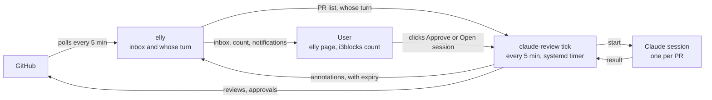

# elly annotations and claude-review runner

Design, 2026-10-30. Not built yet, apart from elly's escaping fix (elly
bde870b). The tool's own README arrives with its code.

elly becomes the review inbox: claude-review runs rounds unattended and marks
each PR in elly as handled or needing the user, with Approve and Open-session
links.

## Problem

The user gets 5–30 review-request emails a day and relays every claude-review
round by hand. Only the first round on a PR gets a human read of the
description and diff; every later round is a click to re-run, then a
copy-pasted approve command.

An unattended runner removes the relay, but its state (this PR is handled,
this one needs the user) must survive a missed notification, a meeting or a
day offline. elly already owns the place the user looks, its page and the
i3blocks count, so that state goes there.

elly must stay unchanged for anyone who runs no such tool, and must never
learn what Claude is.

## Who owns what

Two tools, one boundary: elly reads GitHub and shows the inbox; claude-review
does everything Claude-shaped, including deciding when a round runs.

| Concern | elly | claude-review |
| --- | --- | --- |
| Poll GitHub, store PR facts | yes | no |
| Score whose turn it is (points) | yes | no |
| Show the inbox: page, i3blocks count | yes | no |
| Send desktop notifications | yes | no |
| Store and render annotations, with expiry | yes, generic | no |
| Review one PR in a session (prompts, clone, PR-derived session id) | no | yes, as today |
| Refuse a round while the PR's session is open | no | yes, as today |
| Approve at the reviewed commit (`approve --at`) | no | yes, as today |
| Decide when a round runs (elly's verdict plus its ledger) | no | new: `tick` |
| Read a finished round's outcome (approve line, question line) | no | new: `tick` |
| Write annotations to elly | no | new: `tick` |
| Handle clicks on annotation links | no | new: `approve` and `attach` verbs on `claude-review://` |
| Write to GitHub | never | yes: reviews, replies, approvals |

elly stays read-only toward GitHub. An approval goes out through
`claude-review approve`; elly's next poll sees it, and the next tick drops the
annotation. GitHub holds the approval and the annotation is an expiring cache,
so no state is kept in two places.

claude-review moves from a draft PR in a work repo into this repo, so prompt
changes and the runner ship without review rounds. A cut-down version can
return to the team later.

## Flow



Only claude-review writes to GitHub: reviews on its own, approvals only on the
user's click. elly reads GitHub and shows what the user owes.

## claude-review: what it gains

One binary, no daemon: a systemd user timer runs `claude-review tick` every 5
minutes, matching elly's poll, and each tick exits when done.

1. Read `GET /api/v0/prs` from elly. If elly does not answer, write nothing
   and exit; existing annotations expire on their own.
2. Pick the PRs that are accepted and whose turn it is. Accepted means a
   claude-review session already exists for the PR, created by the user's own
   first `claude-review://` click after reading it on GitHub. Whose turn comes
   from elly: review requested, re-review requested, `ThreadsActionable` above
   zero, or a new head commit since the last round.
3. Skip a PR the ledger already ran at the same head commit and elly state.
   The ledger is a small sqlite file in `~/.local/state/claude-review`.
4. Start the round with `terminal: false`, a detached background session, at
   most 2 at once, under `capped`. A PR whose session is running or open in a
   terminal starts nothing, by the same check a click uses today.
5. For rounds that finished since the last tick, read the session's last
   message. The approve line (`claude-review approve <url> --at <sha>`) becomes
   a `needs_you` annotation with an Approve link. The question line becomes
   `needs_you` with an Open-session link. Anything else becomes `handled` with
   a link to the round's summary review.
6. Re-send every live annotation with a fresh expiry, and delete the ones for
   PRs that are approved, merged or gone.

New pieces besides `tick`:

- **Question line**: the review prompt gains a fixed closing line for a round
  that ends with a question only the user can answer, the way a clean round
  already ends with the approve line.
- **URL verbs**: `claude-review://<owner>/<repo>/<n>/approve?at=<sha>` runs
  `approve --at`, which refuses if the head moved since the review.
  `claude-review://<owner>/<repo>/<n>/attach` opens a terminal on the session.
  Both extend the path the userscript, Thunderbird and wee already open
  (`claude-review://<owner>/<repo>/<n>`), so those keep working unchanged and
  an org named like a verb cannot collide.
- **Ignore** is elly's existing bury; claude-review never runs a buried PR.
- **Work owners only**: `tick` touches PRs whose repo owner is in
  `work_owners` in claude-review's config. Any other owner is never run and
  never annotated, so an open-source PR the user contributes to never gets an
  unattended review posted under their name. A missing owner only means no
  automation.

An approve line conditioned on CI ("approve once green") counts as approve: a
red build is the author's to fix.

Whether an approval survives the author's next push is a per-repo setting
(dismiss stale approvals), and it can change. `tick` never reads the setting;
it reads the result. After a clean round it asks GitHub for the user's latest
review on the PR. Only when no approval of the user's stands does the round
become `needs_you` with an Approve link; otherwise it is `handled`. In a repo
that keeps approvals, a CI-fix push costs nothing; in one that dismisses them,
the push triggers a round and a clean round brings the Approve link back. elly's
`ReviewStatus` is not used for this: it is the PR's overall decision, so
another reviewer's approval would read as the user's.

## elly annotations: storage and API

Annotations get their own table, because elly replaces the `prs` table on
every fetch and a column there would be wiped every 5 minutes.

```sql
create table if not exists annotations (
    pr_url     text not null,
    source     text not null,
    state      text not null check (state in ('handled', 'needs_you')),
    note       text not null default '',
    links      text not null default '[]',
    expires_at text not null,
    primary key (pr_url, source)
);
```

Rows for PRs elly no longer lists are never joined, and get deleted on the
next write.

```
PUT    /api/v0/prs/{prUrl}/annotations/{source}
       {"state":"needs_you","note":"…","links":[{"label":"…","url":"…"}],"expiresAt":"2026-10-30T14:15:00Z"}
DELETE /api/v0/prs/{prUrl}/annotations/{source}
GET    /api/v0/prs    each row gains Annotations: [...], unexpired only, expiresAt as stored
```

`{prUrl}` is encoded as in the existing bury and golden routes. `source` is
free text to elly; claude-review writes as `claude-review`.

The links claude-review writes:

| Link | When | URL |
| --- | --- | --- |
| Approve | round ended with the approve line | `claude-review://<owner>/<repo>/<n>/approve?at=<sha>` |
| Open session | round ended with the question line | `claude-review://<owner>/<repo>/<n>/attach` |
| Round summary | every finished round | `https://github.com/<owner>/<repo>/pull/<n>#pullrequestreview-<id>` |

## Validation and rendering

elly rejects anything outside these limits on write, and escapes everything
on render.

| Field | Rule |
| --- | --- |
| `prUrl` | a PR elly currently lists, else 404 |
| `source` | 1–40 characters of `[a-z0-9-]` |
| `state` | `handled` or `needs_you` |
| `note` | at most 200 characters, plain text |
| `links` | at most 4, each exactly `{label, url}` |
| `label` | at most 40 characters, plain text |
| `url` | at most 2048 characters; scheme `https` or one named in elly's `-annotation-schemes` flag, empty by default |
| `expiresAt` | RFC 3339, between 1 minute and 24 hours from now; stored as is in `expires_at` and returned unchanged |
| body | at most 4 KiB, unknown fields rejected |

- The page uses `html/template` since elly bde870b, so `note` and `label` are
  escaped. Before that, PR titles rendered raw.
- `html/template` replaces a non-http(s) `href` with `#ZgotmplZ`. An
  allowlisted custom scheme is passed as `template.URL` only after the check
  above, repeated at render time against the current flag, so restarting elly
  without the flag revokes the scheme.
- With no annotations, the page and the count are exactly as today.

## Effect on the count

The i3blocks number becomes the PRs that need the user, so zero is reachable
again.

- `handled`: the PR drops out of the count and sorts below everything on the
  user; the row stays visible with its note.
- `needs_you`: the PR counts and sorts as on the user even when elly scores it
  0, for example a clean round on a PR elly sees as waiting on the author.
- Two sources disagreeing: `needs_you` wins.
- An expired annotation is ignored, so a dead runner fails toward showing more
  PRs, never fewer.

## Notifications

elly sends every notification, and claude-review sends none: one notifier
covers the user's own PRs and claude-review's results alike.

On each fetch elly compares every PR's point reasons with the previous fetch.
A PR that gains one of the reasons below gets one desktop notification: the PR
title and the new reason in elly's own words. A `needs_you` annotation counts
as a reason, its note as the words.

| Event | Reason elly already computes |
| --- | --- |
| Own PR approved | Own PR is approved, should be a simple merge |
| Comments on own PR, or replies to the user's threads | Someone asked us something, or reacted to our comment (n comments) |
| Changes requested on own PR | Someone wants you to change something |
| Review requested from the user | the reasons for someone else's PR entering the inbox |
| claude-review round finished clean or with a question | the annotation's note |

Only these reasons notify. Score-only reasons (PR size, staleness, who
commented last, drafts) move the count and the sort but never interrupt,
otherwise every comment anywhere would ping.

- Normal urgency, so it times out: the inbox and the count hold the state, a
  missed notification loses nothing.
- Clicking it opens the elly page.
- Sent once per PR and reason; the last reasons per PR are kept in elly's
  database so a restart does not re-send.
- Off unless elly is started with `-notify`, so a stock elly behaves as today.
- Needs nothing from annotations or Claude, so it can ship first.
- The filtered reasons above apply to owners named in `-work-owners`. A PR
  from any other owner, such as an open-source contribution, notifies on every
  change by someone else: a comment, a review, an approval, a push. elly sees
  each from fields it already stores: `LastUpdated` moving with someone else as
  `LastPrCommenter`, a new `HeadRefOid`, or a changed `ReviewStatus`. Unknown
  owners therefore get the loud default, the safe side for PRs the user must
  act on in person.

## Trust

Any local process can write annotations, the same trust as elly's existing
unauthenticated `PUT /api/v0/config/pat`. elly listens on `localhost:9876` by
default, and it is single-user on one laptop.

Worst case for a hostile local writer: a PR hidden from the count for up to 24
hours (the TTL ceiling), or a link with an allowlisted scheme on the page. A
process that can do that can already replace the PAT.

## Open questions

None. Settled: the state is named `needs_you`; a systemd user unit reaches
the notification daemon over the session bus (checked 2026-10-30); approval
survival is read per PR, not per repo setting (above).
