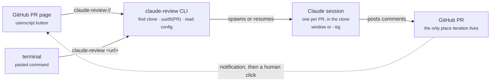
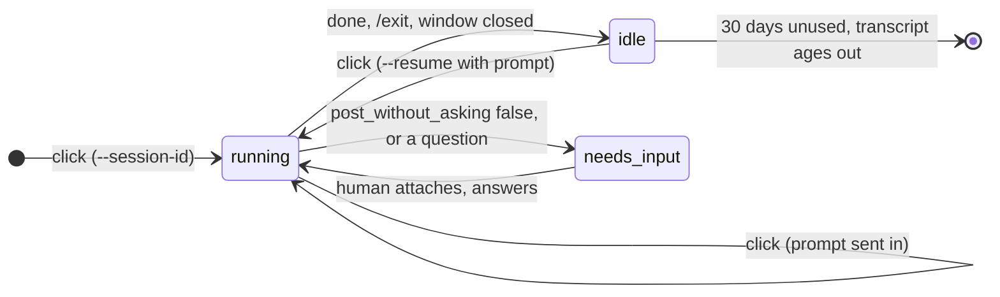
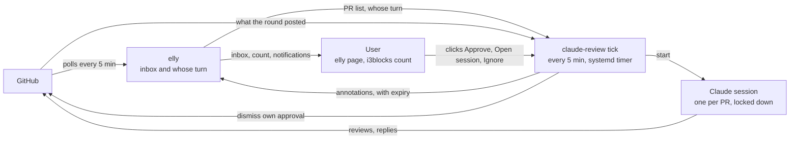

# claude-review

One click on a GitHub PR page starts, or resumes, a Claude Code review
session for that PR in your local clone. The agent never loops; the PR page is
the inbox.

```
claude-review https://github.com/acme/widgets/pull/1234
claude-review claude-review://acme/widgets/1234
claude-review acme/widgets/1234
claude-review --dry-run <pr>     # print the claude command instead of running it
claude-review post <pr> comment|inline|reply|review --body TEXT   # what the session posts with
claude-review threads <pr>       # what is already on the PR, with ids to reply to
claude-review approve <pr> --at SHA   # yours: approve SHA if it is still the head
claude-review slack [--dry-run] <pr>...   # lines to paste when pinging a reviewer
```

## Goal and non-goals

Make the review flow that works today by hand, in a terminal opened in the
PR's repo, reachable from the PR page in one click and shareable across Linux
and macOS. The agent reads the PR, posts findings signed `--claude`, and later
rounds resume the same session so the context carries over. Human comments and
the author's own Claude mix freely on the PR, which stays the only place
iteration happens.

- **Not a daemon.** Nothing of ours runs in the background. Claude Code's own
  session store is the only persistent state. The unattended runner designed
  below changes this for accepted PRs only, as a timer-run one-shot.
- **Not a babysitter.** Whatever brings you to the PR today (GitHub
  notifications, the GitHub Slack app) is the inbox; the button is on the page
  you land on. With the runner, elly's page becomes that inbox.
- **Not CI review.** The per-repo review workflows and claude-code-action are a
  separate topic. Anthropic's managed Code Review at $15–25 per review is out.

## Shape



Every surface ends in the same CLI call. The loop closes through a
notification and a human click, never through the agent.

## Install

Linux and macOS. Needs `go`, an authenticated `gh` and Claude Code.

In this repo, nix builds it (`package.nix`, tests included) and
`nix/home.nix` registers the URL handler and writes the config, so steps 1
and 5 are done by `home-manager switch`. Elsewhere:

1. Build the binary:

   ```sh
   go install .    # from this directory -> $(go env GOPATH)/bin/claude-review
   ```

2. Trust each repo once: run `claude` in your clone and accept the trust
   prompt. Without it the first click fails with "Workspace not trusted".

3. Try it from a terminal:

   ```sh
   claude-review https://github.com/acme/<repo>/pull/<n>
   ```

4. Add the button: install `userscript/github-claude-review.user.js` in
   Violentmonkey or Tampermonkey. Every PR page then shows "copy cmd", which
   copies the command from step 3.

5. Optional, Linux: make the "claude review" button open a terminal directly
   by registering the URL scheme. Adjust the `Exec` path to your
   `$(go env GOPATH)/bin`:

   ```ini
   # ~/.local/share/applications/claude-review.desktop
   [Desktop Entry]
   Type=Application
   Name=claude review
   Exec=/home/you/go/bin/claude-review %u
   NoDisplay=true
   MimeType=x-scheme-handler/claude-review;
   ```

   ```sh
   xdg-mime default claude-review.desktop x-scheme-handler/claude-review
   ```

   Firefox needs three things before a click goes straight through:

   - **The scheme marked external.** In `about:config`, add
     `network.protocol-handler.expose.claude-review` as a boolean set to
     `false`. Without it Firefox blocks the click with "unknown protocol" in
     the console and shows no prompt.
   - **A restart after registering the handler.** Firefox reads the desktop
     entries once at startup, so a handler registered while it runs stays
     "unknown protocol" until a full quit and start. Reloading the page is
     not enough.
   - **Both popup checkboxes ticked once.** The first click asks which app to
     use; tick "Always use claude review". Every click asks whether github.com
     may open the link; tick "Always allow github.com to open claude-review
     links", or the prompt comes back on every click.

   On macOS, use "copy cmd" for now. A locally built AppleScript app with a
   URL type should work without signing, but nobody has verified it yet.

Configuration is optional; the defaults ask before posting anything.

## Config

`claude-review/config.json` under the user config directory
(`os.UserConfigDir()`: `~/.config` on Linux or `$XDG_CONFIG_HOME`,
`~/Library/Application Support` on macOS). Every key is optional.

| key | default | note |
|---|---|---|
| `terminal` | per OS | Absent: `ghostty` on Linux, Terminal.app on macOS. A string: that command instead, with `{dir}` and `{script}` placeholders; the script is written under the user cache dir and runs claude then an interactive shell. `false`: no terminal, the session runs detached with `--bg`. One key, so "a custom command but no terminal" cannot be written. |
| `post_without_asking` | `false` | Pre-approves `claude-review post` for this PR, nothing else. Below. |
| `git_repo_roots` | `["~/code"]` | Where to look for a folder named after the repo. Not passed to the session: it reads only the clone. |
| `clone_path` | `<first root>/{repo}` | Where the "not cloned" message suggests cloning to, with `{owner}` and `{repo}`, e.g. `~/code/github/{owner}/{repo}`. It must end in `{repo}`, at most 3 levels below a root, with no hidden folder, or the next click would not find the clone; anything else is a config error. The CLI itself never clones. |
| `review_prompt` | built in | Later rounds reuse it behind a fixed "new round" preface. `{url}`, `{number}` and `{remote}` are filled in. It replaces the built-in prompt whole, including the rule that a deferred fix ("follow-up PR", "out of scope", "fix later") is a finding when it fits in the PR; copy that rule from `deferralRule` in `command.go` to keep it. |

Unknown keys are an error, so a typo cannot silently change the posting
policy.

```json
{
  "terminal": "kitty --directory {dir} {script}",
  "post_without_asking": true,
  "git_repo_roots": ["~/code", "~/work"]
}
```

### What a click does

`terminal` decides one thing: whether the click opens a terminal window. The
session itself is the same either way and is found by the PR-derived id.
`post_without_asking` is independent of it; all four combinations are
meaningful.

| click | with a terminal | `terminal: false` |
|---|---|---|
| first on this PR | One headless turn creates the session under the PR-derived id (a few seconds, see below), then a new terminal in the clone resumes it with the review prompt. | Same headless turn, then `--bg --resume` with the review prompt. No window. It appears in `claude agents`; `claude attach <id>` opens it when wanted. |
| later, session idle | New terminal; the session resumes with the re-review prompt. | `--bg --resume` with the re-review prompt, detached. |
| later, session still running in the background | The new terminal attaches to it instead of resuming; type the re-review request there. Nothing tracks or focuses the old window. | Nothing is started. A notification names the running session and `claude attach <id>`. |
| later, session still open in another terminal window (or another click's first turn still running) | Nothing is started. A notification names the window's pid; ask for the new round there. | Same. |
| two clicks at once (a double press, the button and a script) | The second finds the first holding the PR's lock and only says so. The first holds it until its window's session is live, so a click a few seconds later sees it open. | Same; the lock is held until `--bg` returns. |
| from a pasted command in a terminal | Runs inline in that terminal; no new window. | Same as a click: detached, prints the id. |

A session counts as open when its id is in `~/.claude/daemon/roster.json`
(background workers) or in a `~/.claude/sessions/<pid>.json` whose pid is
alive with the recorded start time (every other session, `claude -p`
included). The lock is an `flock` on `<user cache dir>/claude-review/<uuid5>.lock`;
the kernel drops it when the click exits, however it exits.

The exact commands (`claude-review --dry-run <pr>` prints them for a PR):

```sh
# first click only: create the session under the PR-derived id. Neither
# `claude --bg` nor an interactive `claude` honours --session-id for the
# transcript (observed on 2.1.283); `claude -p` does, and everything can
# --resume what -p created. One cheap turn, but seconds long, so with a
# terminal it runs inside the new window, chained with && before the resume,
# and the window opens at once.
claude -p --session-id <uuid5> -n "PR: owner/repo#N" --max-turns 1 "<bootstrap prompt>"

# every click, with a terminal. The prompt comes before --allowedTools,
# which takes a list and would swallow a trailing prompt.
claude --resume <uuid5> "<review or re-review prompt>"

# every click, terminal: false. No window, visible in `claude agents`
claude --bg --resume <uuid5> "<review or re-review prompt>"

# a click while a background session is still running, with a terminal
claude attach <uuid5>
```

The first click therefore needs the clone to be a trusted workspace: run
`claude` there once and accept the trust prompt, or the headless turn fails
with "Workspace not trusted": the new window shows that line and drops to a
shell, and with `terminal: false` a notification carries it. The new
terminal window may still open on Claude Code's own safety check (it shows
one whenever the folder's `.claude/settings.local.json` pre-approves
permissions); confirm it and the review prompt is sent.

### Posting policy is a permission, not a sentence

By default the session does all the reading and parks on the first write to
GitHub, waiting for approval. In a window that is the normal permission
prompt; without a terminal the session shows under "Needs input" in
`claude agents` until someone attaches. That holds in Claude Code's default
permission mode. In auto mode the classifier decides instead of prompting,
and may let `claude-review post` through without asking; the deny rules
below still keep every post on that one signed command.

With `post_without_asking` the CLI adds one `--allowedTools` rule, pinned
to the PR, and the session posts and completes:

```
Bash(claude-review post https://github.com/<owner>/<repo>/pull/<n> *)
```

`claude-review post` is this tool's own posting subcommand. It takes the body
only as inline text, calls `gh api` itself, and appends the `--claude`
signature, so every comment is signed on every machine, not only where a
hook enforces it:

```sh
claude-review post <pr> comment --body TEXT
claude-review post <pr> inline  --body TEXT --path FILE --line N [--side RIGHT|LEFT] --at SHA
claude-review post <pr> reply   --body TEXT --to COMMENT_ID   # answer an existing thread
claude-review post <pr> review  --body TEXT        # always a COMMENT review
```

A review posted this way is always a COMMENT: approving or requesting
changes stays a human action, since the command runs without a prompt.
Before posting, the command lists the PR's comments and prints the URL of an
identical one in the same place instead of posting again. GitHub has
answered an inline comment with a 422 after storing it, and the session's
retry left two identical threads; the check makes a retry harmless. "The
same place" is path, side, and line in the `--at` commit for an inline comment and the thread
for a reply. A PR-level comment or review has no place, so only an
identical one from the last 10 minutes counts, and a later round can still
repeat a short summary. An inline comment anchors on `--at`, the full sha
the session reviewed (`git rev-parse FETCH_HEAD`), not on the head at
posting time: a push in between would otherwise put the old line number on
new code.

### Approving is one command, and never the session's

The session never approves. A round that finds nothing says in its summary
which commit it reviewed and ends by printing:

```sh
! claude-review approve https://github.com/<owner>/<repo>/pull/<n> --at <sha>
```

Typed in the session's window, the `!` runs it as your own shell command.
It approves only when `<sha>` is still the PR head, binds the approval to
that commit, and after a push refuses with "click claude review again".
It reads nothing from the PR's comments: the session writes those, so any
marker in them could be planted by a prompt injection. The sha is visible
in the command you run, and a wrong one can at worst approve the current
head, which running the command already chose to do. There is deliberately
no config option to approve automatically: an approval counts toward
branch protection under your name, and the session reads untrusted PR
content.

Every launch, with or without `post_without_asking`, also passes
`--allowedTools` for the read-only `claude-review threads <pr>` and
`--disallowedTools` for the ways around this command: `gh api`,
`gh pr comment|review|edit|merge|close`, `gh issue comment` and
`claude-review approve`. That
matters in auto mode, where the classifier rather than the allow list
decides, and where a session once answered a thread with a raw `gh api`
POST because the tool had no `reply`. Deny rules hold in every permission
mode. They match the command prefix, so `curl` with a token, or `gh` behind
a wrapper such as `sh -c`, is not covered; the classifier is what stands
in front of those.

Why not pre-approve `gh` directly: Claude Code matches everything before a
`*` literally and the `*` matches any text, so a rule cannot constrain
flags, and `gh` has several that read a file into a body (`--body-file`,
`-F`, `--input`, `-F key=@file`). The posting subcommand has no such flag,
a `$(cat file)` substitution is matched by Claude Code as its own command,
and a review through it is always a COMMENT.

Blast radius of `post_without_asking`, stated plainly: the session reads
untrusted PR content, and anyone who gets you to click a `claude-review://`
link can start it. Claude's own Read and Grep tools need no permission
inside the clone, so a prompt injection can read any file there, a `.env`
included, and post its contents as inline `--body` text, as a comment or a
non-approving review, on that PR under your account. It cannot approve,
request changes. Whether it can reach anything beyond the PR depends on your
own Claude Code settings, which the session inherits: with auto mode and
`Bash(curl *)` or a broad `Bash(gh *)` allowed, the deny rules above leave
`curl`, `gh gist create` and `gh repo clone` open, so what it reads can leave
the machine and other repositories can be fetched. Anything readable in the
clone can end up on the PR either way. Leave it off unless you want that trade; reviewing with the default
(ask) keeps every post behind a prompt you see.

## The local clone

The clone is context, not the subject. The session starts in it so the repo's
own `.claude/` skills, agents and settings load (they load from the cwd, which
is why the parent folder of all repos is not the cwd). It reads only the
clone: sibling repositories are not added, so a malicious PR cannot reach
them. Cross-repo context may come back once there is usage to judge it by.
It reads CLAUDE.md, skills
and history from the clone, and gets the PR itself from GitHub with
`gh pr view`, `gh pr diff` and `git fetch <remote> pull/N/head` followed by
`git show`, where `<remote>` is the clone's remote that points at the PR's
repository (`upstream` in a fork-style clone). Two rules follow.

- **The CLI never runs a git command that writes or touches the network.**
  Finding the clone is reading remotes. No fetch, no checkout, and never a
  clone: a click must not create a repository on disk.
- **The review prompt forbids changing the working tree.** No checkout, no
  branch switch, no stash, no edits. The clone may be someone's live work,
  including the author's own writer session on the same PR.

| situation | what happens |
|---|---|
| no checkout named `<repo>` under any root, or its remotes do not resolve to owner/repo | Exit with "not cloned", the `clone_path` it expected and `gh repo clone <owner/repo> <clone_path>` (gh picks https or ssh), then click again; a new clone still needs trusting once (install step 2). On Linux a short notification whose one action, run by dunst's middle click, copies that command with `xclip`; on macOS the command is in the notification; from a terminal it is on stderr. |
| several directories match | Shortest path wins, alphabetical among equals. Only checkouts (a `.git` entry) with the exact folder name are candidates, so a `webapp-old` next to `webapp` is never picked. A same-named folder that is not a checkout is searched through, so `~/code/github/grafana/grafana` is found. |
| a folder inside another clone is named `<repo>` | Never a candidate: the search does not enter a checkout. A cloned tree can hold a folder shaped like a bare repository (`HEAD`, `config`, `objects/`, `refs/` committed as files) whose config names any remote and runs commands through `core.sshCommand`; git also gets `safe.bareRepository=explicit`. |
| clone is on another branch, dirty, or behind | Irrelevant. Nothing is checked out; the session fetches the PR head into `FETCH_HEAD` and reads from there. A stale clone only makes `git log` context older. |
| the matched directory is a `git worktree` checkout rather than a main clone | No difference for finding it: detection reads remotes, which works for both. |
| the directory a session started in was removed | The next click re-finds the repo by folder name and resumes there. `claude --resume <id>` searches every project on the machine. The transcript is never lost; the directory only decided where it was filed. |
| remote is not named `origin` | Any remote whose URL resolves to owner/repo counts, and the prompt fetches the PR ref from that remote by name, so a fork-style clone (`origin` = your fork, `upstream` = the repo) works. |
| reviewing your own PR while a writer session has the clone open | Two sessions in the same directory with different ids. Fine, because neither the CLI nor the reviewer writes to the tree. |
| `gh` is not authenticated | The session's first `gh` call fails and says so. The CLI does not pre-check; it would only duplicate the error. |

### Why read-only

Three ways to give the session the PR's code were on the table.

- **Read-only in the existing clone (chosen).** The session fetches the PR ref
  and reads it with `git show` and `gh pr diff`. The developer's checkout is
  untouched. Cost: the reviewer cannot run the PR's tests or build.
- **A worktree per review.** Claude Code's `--worktree` flag gives the session
  its own checkout of the PR head, so tests can run. Cost: a directory per PR
  that we create and nobody removes, and a session whose home directory is that
  disposable worktree. Remove it and every later round resumes somewhere else
  than where its history happened.
- **A throwaway clone per review.** Full isolation, but a clone of a private
  repo on every click, which the rule above forbids.

## Sessions

- **parallel reviews**: independent sessions, one per PR. With a terminal
  that is one window each. `claude agents` lists them grouped by state;
  `a:PR:` filters on the name prefix.
- **re-review**: same command every time. A finished session resumes with the
  prompt, which points it at `claude-review threads` and tells it to reply in
  existing threads, never to repeat a finding already on the PR, and to post
  nothing when there are no new commits or replies; a running background one is attached instead, and one open in a window is left alone. "Re-review" means a
  transcript exists, so if the first click's bootstrap succeeded but the
  review never started (window closed mid-way, `--bg` failed), the next click carries the re-review preface
  although no review ran yet; the model copes with the missing round.
- **listing**: shared with every other session on the machine. No
  namespaces; the `PR:` name prefix is the separation.
- **`CLAUDE_CONFIG_DIR`**: if you move Claude Code's store, export the
  variable in your session or login environment, not only in a shell rc
  file. The CLI checks the store from its own environment, and a URL
  handler does not read rc files, so it would look in `~/.claude` and treat
  every click as a first one.
- **persistence**: Claude Code's own store. Transcripts under
  `~/.claude/projects/` age out after 30 days unused (`cleanupPeriodDays`);
  background sessions survive sleep and resume after a reboot.
- **own PRs**: reviewing your own PR in a separate session needs nothing
  extra. The writer session picks the comments up on the PR, as today.



One session per PR, created on the first click and resumed by every later one.
Nothing of ours runs between clicks; "idle" is a file. With a terminal,
nothing runs once the window is closed. With `terminal: false`, finished
sessions also stay listed in `claude agents` until `claude rm <id>`; the
transcript survives that too.

## Pinging a reviewer

`claude-review slack <pr>...` prints one line per PR to paste into Slack,
`- <PR URL>: <a few words>`, and nothing else. A PR that must not go to a
reviewer yet gets no line: its reasons go to stderr and the exit code is 1.

| refused when | read from |
|---|---|
| not open, or a draft | `gh pr view --json state,isDraft` |
| merge conflict, or GitHub has not computed mergeability yet | `mergeable` |
| any check red or pending | `statusCheckRollup`, as `(.conclusion // .state)`: Buildkite rows are commit statuses whose conclusion is always empty |
| an unresolved review thread whose last comment is not the PR author's | `reviewThreads` over `gh api graphql`; the REST comments `threads` prints carry no resolution |

`reviewDecision` is not read: it says whether an approval exists, not whose
turn it is. The words come from one headless `claude -p` turn with no tools (`--tools "" --strict-mcp-config`),
given the commit subjects since the latest review by a person other than
the author (apps excluded by REST `user.type`) and the replies
on that reviewer's threads. With the PR's review session on this machine it
resumes that session (`--resume <uuid5> --no-session-persistence`, so the
turn is not added to the transcript); without one it starts fresh. The CLI
writes the URL itself and rejects a reply that is not one short line or
names a PR as `#N`. The PR text in the prompt is untrusted, so read the
line before pasting it. `--dry-run` runs the gate and prints the claude
command instead.

## Decisions

| | decision | why |
|---|---|---|
| decided | URL scheme, not a localhost server | A server only wins if it removes per-OS setup, and it adds a service unit, CORS and a token instead. |
| decided | No daemon of ours | Claude Code already tracks sessions on both OSes. Nobody wants to maintain launchd units. |
| decided | Agent never loops | Triggers are polling (tokens) or webhooks (hosted infra). The PR is the state; each round is a stateless click. |
| decided | The PR page is the inbox | GitHub notifications and Slack already bring people there; the button waits on the page. |
| decided | Home in the dotfiles repo | Personal tooling: prompt and runner changes ship without review rounds. Moved here from a draft in a work repo on 2026-10-31; a cut-down version can go back to a team later. |
| decided | Repo-specific review knowledge stays in each repo | Launching inside the clone picks up its `.claude/`; this tool carries none of it. |
| decided | Never auto-clone | A click must not create a repository on disk. |
| decided | Headless bootstrap turn on the first click | The only way observed to pin the session id; costs one tiny turn and keeps the tool stateless. |
| open | macOS handler | Unsigned local app launching without a Gatekeeper prompt is believed, not verified. |
| open | Per-session worktree | Would let the reviewer run the PR's tests. Needs a cleanup story first. |
| decided | No `--add-dir`, for now | Claude's file tools read only the clone; reaching another repository takes a shell command, which the runner's launch policy denies. Cross-repo context gets revisited once the tool sees usage. |
| decided | `slack` gates in code, words from Claude | Whether a PR may be sent is a fact gh can answer; only the summary needs a model, and the URL never comes from it. |
| open | Clearing finished background sessions | They stay in `claude agents` until `claude rm`. A `claude-review gc` for merged or closed PRs would need `gh`. |

## Unattended runner and elly annotations

Design, 2026-10-30, persona-reviewed and revised 2026-10-31, built
2026-10-31. elly's side (escaping, notifications, Host/Origin checks,
annotations) and this tool's `tick`, launch policy and URL verbs follow it.
The timer ships disabled.

### Running it

1. List the repos in `review_repos` in the config (`owner/*` or
   `owner/repo`), or one per line in a `review-repos` file beside it, for
   names that should stay out of a shared config. Optional: `daily_cap` (6), `max_running` (2),
   `round_wrapper` (a command prefix such as `["capped"]`), `elly_url`
   (`http://localhost:9876`), `github_user` (asked of gh when empty).
2. Start elly with `-annotation-schemes=claude-review`, so its page renders
   the links.
3. Click claude review on a PR as usual: in a listed repo, that click is the
   acceptance tick needs.
4. `claude-review tick --dry-run` prints what a tick would do and changes
   nothing: no round, no ledger row, no annotation.
5. In these dotfiles the `claude-review-tick` service and timer exist in
   `nix/home.nix` without an Install section, so nothing runs until one is
   added there; `systemctl --user start claude-review-tick` runs one tick by
   hand.

elly becomes the review inbox: claude-review runs rounds unattended and marks
each PR in elly as handled or needing the user, with Approve and Open-session
links.

### Problem

The user gets 5–30 review-request emails a day and relays every claude-review
round by hand. Only the first round on a PR gets a human read of the
description and diff; every later round is a click to re-run, then a
copy-pasted approve command.

An unattended runner removes the relay, but its state (this PR is handled,
this one needs the user) must survive a missed notification, a meeting or a
day offline. elly already owns the place the user looks, its page and the
i3blocks count, so that state goes there.

elly must stay unchanged for anyone who runs no such tool, and must never
learn what Claude is.

### Who owns what

Two tools, one boundary: elly reads GitHub and shows the inbox; claude-review
does everything Claude-shaped, including deciding when a round runs.

| Concern | elly | claude-review |
| --- | --- | --- |
| Poll GitHub, store PR facts | yes | no |
| Score whose turn it is (points) | yes | no |
| Show the inbox: page, i3blocks count | yes | no |
| Send desktop notifications | yes | no |
| Store and render annotations, with expiry | yes, generic | no |
| Review one PR in a session (prompts, clone, PR-derived session id) | no | yes, as today |
| Refuse a round while the PR's session is open | no | yes, as today |
| Approve at the reviewed commit (`approve --at`) | no | yes, as today |
| Ledger: acceptance, ignore, rounds, approve tokens | no | new |
| Decide when a round runs, and with which permissions | no | new: `tick` |
| Read a finished round's outcome, checked against GitHub | no | new: `tick` |
| Write annotations to elly | no | new: `tick` |
| Handle clicks on annotation links | no | new: `approve`, `attach`, `ignore` verbs on `claude-review://` |
| Write to GitHub | never | yes: reviews, replies, approvals, dismissing the user's own approval |

elly stays read-only toward GitHub. An approval goes out through
`claude-review approve`; elly's next poll sees it, and the next tick drops the
annotation. GitHub holds the approval and the annotation is an expiring cache,
so no state is kept in two places.

claude-review moves from a draft PR in a work repo into this public repo, so
prompt changes and the runner ship without review rounds. The move first
scrubs the work repo's org and repo names from the README, the `go.mod`
module path, the userscript `@namespace` and the test fixtures. Nothing secret
was found in it. A cut-down version can return to the team later.

### Flow



Only claude-review writes to GitHub: review comments unattended, approvals
only on the user's click. elly reads GitHub and shows what the user owes.

### claude-review: what it gains

One binary, no daemon: a systemd user timer runs `claude-review tick` every 5
minutes (`OnCalendar=*:0/5`, `Persistent=true`, so a tick missed during
suspend runs on wake), and each tick exits when done.

#### The ledger

A small sqlite file in `~/.local/state/claude-review`, owned by
claude-review alone. It holds:

- **Acceptance**: one row per PR, written by the user's own first
  `claude-review://` click on the PR, with the head and base commit at that
  moment. An existing session file is not acceptance.
- **Ignore**: sticky, set from an Ignore link, cleared by the next first-look
  click. elly's bury stays a display preference: elly unburies a PR whose
  `LastUpdated` moves, so bury cannot stop rounds.
- **Rounds**: each round is recorded when it starts (PR, head, trigger) and
  marked read when its result is processed.
- **Approve tokens**: one-time, minted by `tick` for one PR at one head.
- **Daily round count** per PR.

#### Each tick

1. Read `GET /api/v0/prs` from elly. If elly does not answer, write nothing
   and exit; existing annotations expire on their own.
2. Pick candidates: the repo is in `review_repos` in claude-review's config
   (`owner/*` for a whole owner, `owner/repo` for one repo), the user did not
   author the PR, it is accepted and not ignored, and
   it is the user's turn: review requested, re-review requested,
   `ThreadsActionable` above zero, or a new head commit since the last round.
   Changes made by the user's own account trigger nothing, so a round's own
   review cannot start the next round.
3. Send a PR back to the first-look gate (no rounds, a `needs_you` row asking
   for a fresh look) when its head no longer descends from the accepted head
   or its base branch changed since acceptance.
4. Skip a PR the ledger already started a round for at the same head and
   trigger. Past the per-PR daily cap, mark it `needs_you` with "paused"
   instead of starting a round.
5. Start the round in the PR's session, resumed, with `terminal: false`, at
   most 2 at once, under `capped`, and under the launch policy below. A PR
   whose session is running or open in a terminal starts nothing, by the same
   check a click uses today.
6. For every round the ledger started and has not marked read, decide the
   outcome from GitHub and the ledger, never from the session's text alone
   (next section). Mark it read.
7. Re-send every live annotation with a fresh expiry. Delete one only on
   positive evidence: the user's own approval stands at the current head, or
   GitHub reports the PR merged or closed. A PR missing from one elly read is
   not evidence; its annotation expires instead.

#### Reading a round's outcome

The session's last message carries one of two fixed lines: the approve line
(`claude-review approve <url> --at <sha>`) or the question line,
`claude-review: question for the user`, which every prompt asks for when a
round ends on a question only the user can answer.
Neither is trusted on its own.

- **Approve link**: only when the session's approve line names the PR and the
  head `tick` recorded at the round's start, and GitHub shows that the round
  posted no new review comments and opened no threads, and none of the user's
  threads on the PR are unresolved. The link is built from the ledger, never
  from the session's text, and carries a one-time token. The row shows the
  round summary and how much changed since the user's last approval. No
  confirmation dialog. An approve line conditioned on CI ("approve once
  green") counts as approve: a red build is the author's to fix.
- **Question line**: `needs_you` with an Open-session link.
- **Findings after the user's approval**: when the round posted new review
  comments at the current head while the user's approval stands at an earlier
  commit, `tick` dismisses that approval, with a message ending `--claude`,
  and marks the PR `needs_you`. Any new finding counts; severity is not
  judged. A steered round can therefore block a merge, never let one through.
  This needs write access and no dismissal restriction on the repo.
- **Clean round under a standing approval**: `handled`. Approval survival is a
  per-repo setting that can change, so `tick` reads the user's latest review
  on the PR from GitHub, never the setting and never elly's `ReviewStatus`,
  which is the PR's overall decision and would count another reviewer's
  approval as the user's.
- **`handled` otherwise** needs positive evidence: a review by the user's
  account at the round's head, posted during the round. It links to that
  review.
- **Anything else** (a crash, an expired `gh` token, a rate limit, a stalled
  prompt, a reboot, neither line printed): retry once, then `needs_you` with
  "round failed" and an Open-session link.

`handled` suppresses only the review-owed reasons in elly. A reason outside
the triggers, such as a top-level question from the author, still counts.

#### Launch policy

An unattended round runs with nobody watching, and the PR author picks the
moment by pushing. It must not inherit the user's settings, which today run in
auto mode and allow `Bash(gh *)` and `Bash(curl *)`; the existing deny rules
cover only `gh api`, the `gh pr`/`gh issue` write commands and
`claude-review approve`, so `curl`, `gh gist create` and `gh repo clone` pass.

`tick` owns the launch arguments:

- an explicit permission mode, with the user's settings excluded;
- an allow list scoped to the PR: read the clone, `gh pr view` and
  `gh pr diff` for that PR, `claude-review threads` and `post` for that PR;
- everything else denied, including reads of secret-shaped paths (`.env`,
  key and credential files);
- a test that fails if the launch arguments loosen.

The posting-policy section above states what a round can reach under the
user's own settings today.

Rounds resume the PR's one session, accepting that an instruction planted in
an earlier commit or reply stays in the transcript after the author removes
it. The launch policy and the GitHub checks on Approve bound what it can do:
bad comments or a blocked merge, never an approval.

#### URL verbs

They extend the path the userscript, Thunderbird and wee already open
(`claude-review://<owner>/<repo>/<n>`), so those keep working unchanged and an
org named like a verb cannot collide.

- `claude-review://<owner>/<repo>/<n>/approve?at=<sha>&token=<t>` runs
  `approve --at` only when the token is one `tick` minted for that PR and sha
  and has not been used; anything else is refused. `approve --at` still
  refuses a head that moved since the review. Without the token, anyone who
  can show the user a link (Slack, a web page) could get unreviewed code
  approved in one click, and the head check would not stop them, because the
  author knows the head.
- `claude-review://<owner>/<repo>/<n>/attach` opens a terminal on the session.
- `claude-review://<owner>/<repo>/<n>/ignore` sets the sticky ignore. A
  forged one only stops automation on that PR.

The Thunderbird native host passes only `claude-review://[\w.-]+/[\w.-]+/\d+`
(`re.fullmatch` in `nix/thunderbird.nix`), so mail cannot carry a verb. That
pattern stays, and gets a test.

### elly annotations: storage and API

Annotations get their own table, because elly replaces the `prs` table on
every fetch and a column there would be wiped every 5 minutes.

```sql
create table if not exists annotations (
    pr_url     text not null,
    source     text not null,
    state      text not null check (state in ('handled', 'needs_you')),
    note       text not null default '',
    links      text not null default '[]',
    expires_at text not null,
    primary key (pr_url, source)
);
```

Expired rows are purged on write. A row is never deleted because its PR was
missing from one fetch.

elly's refresh (`StoreRepoPrs`) today deletes every row in `prs` and inserts
the new ones one by one, outside a transaction, so a reader mid-refresh sees a
short list. It moves into one transaction.

```
PUT    /api/v0/prs/{prUrl}/annotations/{source}
       {"state":"needs_you","note":"…","links":[{"label":"…","url":"…"}],"expiresAt":"2026-10-30T14:15:00Z"}
DELETE /api/v0/prs/{prUrl}/annotations/{source}
GET    /api/v0/prs    each row gains Annotations: [...], unexpired only, expiresAt as stored
```

`{prUrl}` is encoded as in the existing bury and golden routes. `source` is
free text to elly; claude-review writes as `claude-review`.

The links claude-review writes:

| Link | When | URL |
| --- | --- | --- |
| Approve | the checks under "Reading a round's outcome" pass | `claude-review://<owner>/<repo>/<n>/approve?at=<sha>&token=<t>` |
| Open session | question line, failed round | `claude-review://<owner>/<repo>/<n>/attach` |
| Ignore | every `needs_you` row | `claude-review://<owner>/<repo>/<n>/ignore` |
| Round summary | every finished round | `https://github.com/<owner>/<repo>/pull/<n>#pullrequestreview-<id>` |

### Validation and rendering

elly rejects anything outside these limits on write, and escapes everything
on render.

| Field | Rule |
| --- | --- |
| `prUrl` | a PR elly currently lists, else 404 |
| `source` | 1–40 characters of `[a-z0-9-]` |
| `state` | `handled` or `needs_you` |
| `note` | at most 200 characters, plain text |
| `links` | at most 4, each exactly `{label, url}` |
| `label` | at most 40 characters, plain text |
| `url` | at most 2048 characters; scheme `https` or one named in elly's `-annotation-schemes` flag, empty by default |
| `expiresAt` | RFC 3339, between 1 minute and 24 hours from now; stored as is in `expires_at` and returned unchanged |
| body | at most 4 KiB, unknown fields rejected |

- The page uses `html/template` since elly bde870b, so `note` and `label` are
  escaped. Before that, PR titles rendered raw.
- `html/template` replaces a non-http(s) `href` with `#ZgotmplZ`. An
  allowlisted custom scheme is passed as `template.URL` only after the check
  above, repeated at render time against the current flag, so restarting elly
  without the flag revokes the scheme.
- A custom-scheme link renders with its verb visible next to the label, so a
  label cannot disguise an approve link as "Open session".
- With no annotations, the page and the count are exactly as today.

### Effect on the count

The i3blocks number becomes the PRs that need the user, so zero is reachable
for review work. elly's scoring of the user's own PRs is unchanged: a stale
or reviewer-less own PR keeps counting until it is closed or shipped.

- `handled`: the PR's review-owed reasons stop counting and it sorts below
  everything on the user; the row stays visible with its note.
- `needs_you`: the PR counts and sorts as on the user even when elly scores it
  0, for example a clean round on a PR elly sees as waiting on the author.
- Two sources disagreeing: `needs_you` wins.
- An expired annotation is ignored, so a dead runner fails toward showing more
  PRs, never fewer.

### Notifications

elly sends every notification, and claude-review sends none: one notifier
covers the user's own PRs and claude-review's results alike.

On each fetch elly compares every PR's point reasons with the previous fetch.
A PR that gains one of the reasons below gets one desktop notification: the PR
title and the new reason in elly's own words. A `needs_you` annotation counts
as a reason, its note as the words.

| Event | Reason elly already computes |
| --- | --- |
| Own PR approved | Own PR is approved, should be a simple merge |
| Comments on own PR, or replies to the user's threads | Someone asked us something, or reacted to our comment (n comments) |
| Changes requested on own PR | Someone wants you to change something |
| Review requested from the user | the reasons for someone else's PR entering the inbox |
| claude-review round needs the user (clean, question, failed, paused, approval dismissed) | the annotation's note |

Only these reasons notify. Score-only reasons (PR size, staleness, who
commented last, drafts) move the count and the sort but never interrupt,
otherwise every comment anywhere would ping.

- Plain text, escaped: the notification daemon renders markup, and a PR title
  or a note must not restyle it (a bold "safe to merge").
- Normal urgency, so it times out: the inbox and the count hold the state, a
  missed notification loses nothing.
- Its default action opens the elly page (middle click in this dunst config; left click only closes).
- Sent once per PR and reason kind, not reason text, so a comment count
  changing in the text does not notify again. The last reason kinds per PR are
  kept in elly's database so a restart does not re-send.
- The first start with `-notify` records a silent baseline. More than three
  notifications from one fetch (say, after a week away) coalesce into one
  summary.
- Off unless elly is started with `-notify`, so a stock elly behaves as today.
- Needs nothing from annotations or Claude, so it can ship first.
- The filtered reasons above apply to owners named in `-work-owners`. A PR
  from any other owner, such as an open-source contribution, notifies on every
  change by someone else: a comment, a review, an approval, a push. elly sees
  each from fields it already stores: `LastUpdated` moving with someone else as
  `LastPrCommenter`, a new `HeadRefOid`, or a changed `ReviewStatus`. Unknown
  owners therefore get the loud default, the safe side for PRs the user must
  act on in person.

### Trust

elly listens on `localhost:9876` with Go's default mux, and today no handler
checks Host or Origin. A web page can POST bury and refresh blind, and one
using DNS rebinding can read the PR list (private repo titles) or replace the
PAT. With annotations it could also hide PRs. elly therefore gains:

- requests whose `Host` is not its listen address are rejected;
- writes with a cross-site `Origin` are rejected;
- annotation writes need a bearer token read from a 0600 file under
  `$XDG_RUNTIME_DIR`.

Worst case for a hostile local process, which can read that file: a PR hidden
from the count for up to 24 hours (the TTL ceiling), or a link with an
allowlisted scheme on the page. An approve link it writes still fails without
a token from claude-review's ledger.

### Open questions

None for the design. Settled: the state is named `needs_you`; a systemd user
unit reaches the notification daemon over the session bus (checked
2026-10-30); approval survival is read per PR; unattended rounds post without
the user reading each one, inside the launch policy; Approve is one click with
a ledger token; `tick` dismisses the user's own approval when a later round
posts findings; rounds resume the PR's session; own-PR scoring stays as it is.

### Policy decisions

These are answers about people and permission, not engineering. Each one
holds until whoever owns it says otherwise; the last column says what changes
in the design when it flips. Settled 2026-10-31.

| Question | Asked of | Answer | If it flips |
| --- | --- | --- | --- |
| Is it OK that the reviewer posts follow-up review comments on colleagues' PRs automatically, signed --claude, without the user reading each one first? | Engineering manager, or whoever owns AI use | Yes | Unattended rounds stop posting; each round's comments wait for the user as a draft, and `needs_you` carries "review the draft" |
| Does the user's approval count as the required review when the user clicks Approve on the reviewer's verdict for a follow-up push, without re-reading the diff? | Engineering manager | Yes | The Approve link opens the diff since the user's last approval instead of approving; the user approves from there |
| Is AI PR review a team deliverable, or personal tooling? | Team lead | Personal; the experiment feeds something more generic later | The tool moves to a team repo, and prompt and runner changes go through review |
| Which repos may get automated review comments? | Each repo's owning team | A per-repo allowlist in the config (`review_repos`); a large shared monorepo is deliberately left out | Add or remove the repo in `review_repos`; nothing else changes |
| Should a new round run on every push to a reviewed PR, or only after a re-review request? | Colleagues reviewed most often | Every push | Drop "new head commit" from the triggers; re-review requests and thread replies still start rounds |
| May one Claude seat run background reviews, a few dozen a day, or does that need a separate budget? | Owner of the Claude licences | The user's seat covers it; the per-PR daily cap is the only brake | Add a daily total across all PRs, past which `tick` starts nothing and rows read "paused" |
| Is anyone using or waiting on the earlier team-repo draft? | Colleagues | No one had seen it | Nothing; the draft is closed when the code moves |

The policy questions are answered under "Policy decisions" above. elly's
`-work-owners` only decides how loudly an owner notifies; which repos get
rounds is `review_repos`.

## Development

```sh
go test -cover ./...      # 90.6% of statements on 2026-10-31
golangci-lint run ./...
make props-long           # the rapid property tests, 10000 cases each
make mutate               # gremlins, one worker
```

The last two are slow, so `.github/workflows/claude-review-slow-tests.yml`
runs them daily rather than on every push. Every invariant the runner rests
on has a test that was first shown failing with the check removed: the
pinned launch arguments, the one-time approve token, the Thunderbird host's
pattern, the dry run that writes nothing.

`package.nix` runs the tests in every nix build of the home configuration, so
a failing test fails `home-manager switch`.

Verified by hand on Claude Code 2.1.283 (Linux): `-p --session-id` creates
the transcript under the given id; `--bg --session-id` and an interactive
`--session-id` do not; `--bg --resume` on an id without a transcript crashes;
`--resume` into a running background session is refused with an attach hint;
`--bg` in an untrusted directory fails with "Workspace not trusted";
`--disallowedTools "Bash(gh api *)"` blocks `gh api` under
`--permission-mode auto`. On 2.1.310: a window started with
`claude --resume <id>` records `<id>` in `~/.claude/sessions/<pid>.json`, as
does `claude -p --session-id <id>`, and `procStart` there is field 22 of
`/proc/<pid>/stat` (`ps -o lstart=` without a /proc, read from the binary,
not run on a Mac). Not yet verified: whether the deny rule also
catches `command gh api` or `env gh api`, whether a `!` command typed by
the user runs despite the session's deny rules (expected, since those govern
the model's tool calls), whether `--allowedTools` on the resume line blocks sending a prompt
into a running session on 2.1.285 or later, and the macOS handler.
