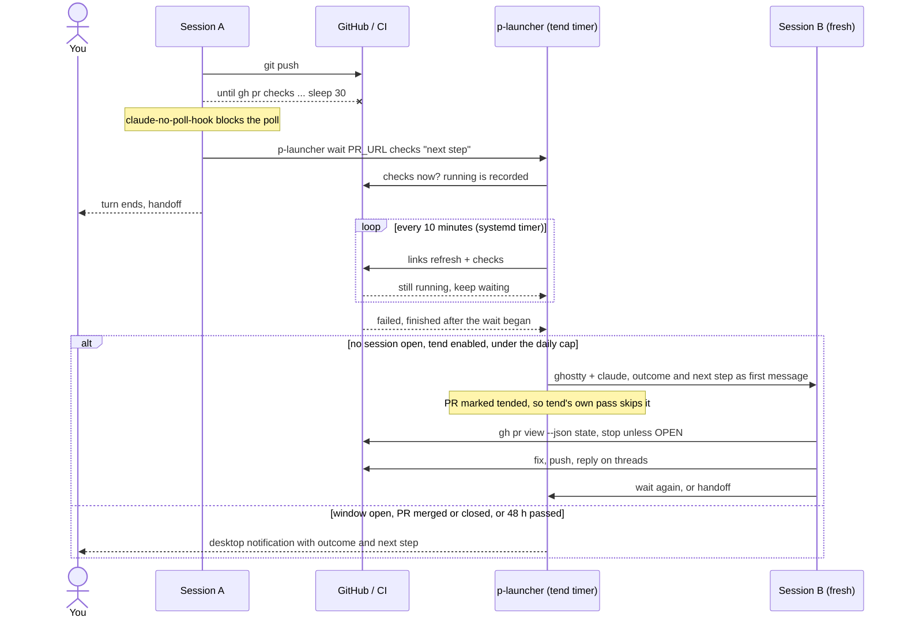
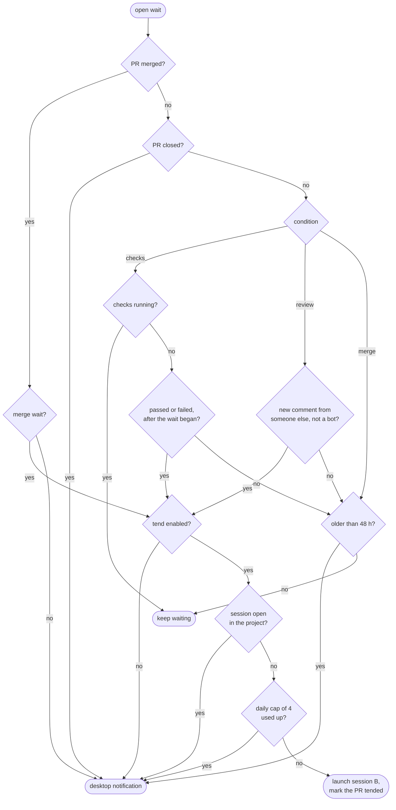

# p-launcher

One hotkey opens any `~/p` project in a Claude Code terminal, shows whose turn
it is per project (you, Claude, a reviewer), and reports weekly on how many
things to run at once.

- `menu` is bound to F5 (rofi): projects sorted by urgency (asks, finished
  waits, reviewer waits, working, idle; oldest wait first), a verb
  submenu per project (open, archive, postpone, rename, add link, context),
  docked `brief…`, `archived…` and `report…` rows.
- Claude Code hooks call `hook` on every event; the ball state and an event
  log land in `~/.local/share/p-launcher/p.db` (SQLite, migrated in place).
- `report` renders a self-contained HTML dashboard from that data; `--demo`
  shows it with placeholder numbers.
- `brief` (weekday mornings, systemd user timer) writes the daily PR brief:
  one read-only headless Claude run over elly's queue plus the launcher's own
  state, stored with its items so the next brief knows what it already
  recommended, rendered to `brief.html` and opened from the `brief…` row.
  `--dry-run` prints the prompt without spending a run, `--show` prints the
  stored brief, `--force` runs a second time the same day.
- `links refresh` and `tend` (on a systemd user timer) track PR links via
  GitHub and elly, and can start a Claude session to address review feedback
  once enabled.
- `wait <pr-url> checks|review|merge <next step>` is what a session runs
  instead of polling (`claude-no-poll-hook` blocks the polling inside `~/p`).
  `tend` resolves waits before its own pass: a fresh session with the next
  step when none is open in the project, a notification otherwise. `wait list`
  shows the open ones.

## Waits

A session that pushed and now needs CI or a reviewer registers a wait and
ends its turn, instead of polling inside its own context. The `tend` timer
picks the thread back up.

The resumed session may fix code, push and reply on review threads. It never
opens PRs, requests review, approves, merges or resolves threads; those go to
`## Open decisions` in the project's HANDOFF.md.

How `tend` resolves each open wait (`waitOutcome` and `runWaits` in
`wait.go`):

Every outcome except "keep waiting" closes the wait. The daily cap is shared
with `tend`'s own sessions.

Design notes and the handoff live outside this repo, in
`~/p/personal/p-launcher/`. Tests: `go test ./...`; screenshot goldens with
`P_LAUNCHER_E2E=1` (Xvfb, rofi, ImageMagick, firefox).
